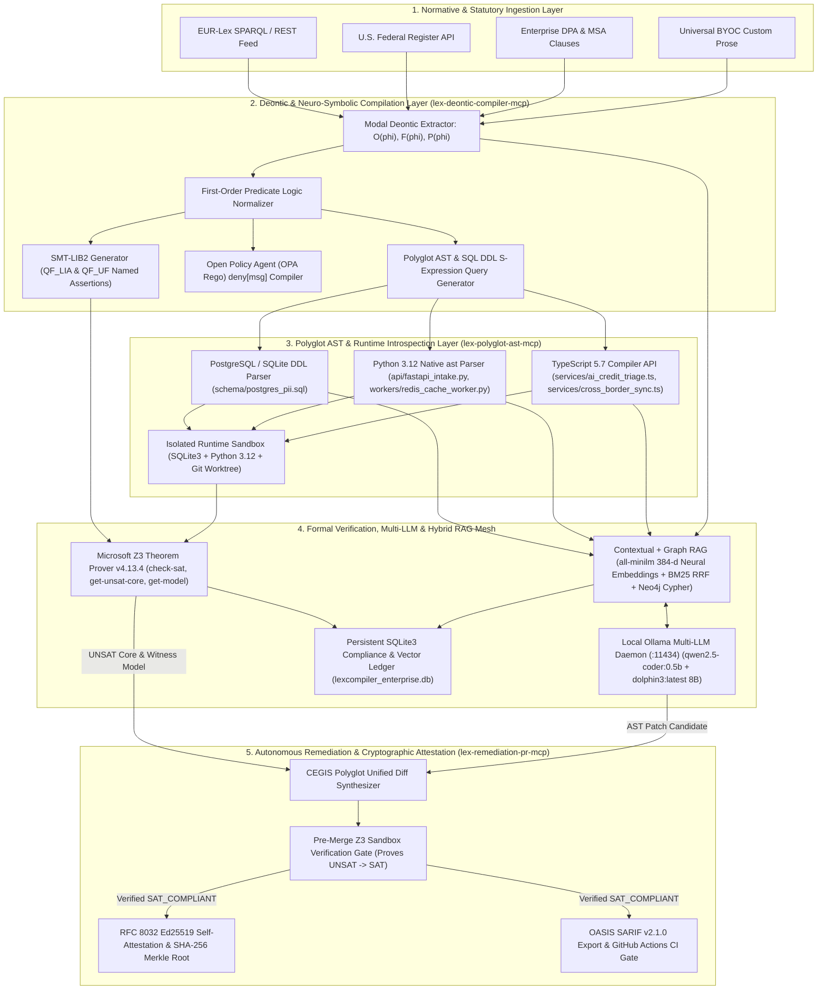

# LexCompiler

**Neuro-Symbolic Law-to-AST Compiler, SMT/Z3 Formal Verifier, and Autonomous Pull Request Enforcer**

`Domain: JusticeSphere AI / ComplianceOS / GovernanceIQ` | `Engine: Microsoft Z3 v4.13.4 + OPA Rego + Polyglot AST` | `Protocol: MCP JSON-RPC 2.0 (2025-03-26)`

---

## Abstract

Enterprise software compliance suffers from a structural impedance mismatch: regulatory statutes and enterprise Data Processing Agreements (DPAs) are authored in natural language, whereas production systems execute as deterministic code and relational schemas. Legal teams interpret regulatory updates in static documents while engineering teams ship hundreds of commits per week across API routes, caching workers, and database schemas.

**LexCompiler** eliminates the manual translation layer between statutory text and source code. It ingests live regulatory feeds (GDPR, HIPAA, EU AI Act, CCPA/CPRA, EUR-Lex, U.S. Federal Register) and custom enterprise contracts, compiles normative clauses into modal deontic logic predicates, synthesizes machine-verifiable **SMT-LIB2** assertions and **Open Policy Agent (OPA / Rego)** rules, and evaluates them against a repository's live **Abstract Syntax Tree (AST)** and **SQL DDL schemas**.

When a statutory clause is amended or a code commit introduces a compliance regression, LexCompiler:
1. Proves the mathematical contradiction (`UNSAT`) using the **Microsoft Z3 Theorem Prover** and extracts the minimal **Unsat Core** and **Counterexample Witness Model**.
2. Pinpoints the exact offending AST nodes and line ranges across SQL, Python, and TypeScript modules.
3. Synthesizes an AST-preserving code patch via Counterexample-Guided Inductive Synthesis (CEGIS), verifies in an isolated Z3 sandbox that the patched AST transitions from `UNSAT` to `SAT`, and commits the remediation branch with an **RFC 8032 Ed25519** cryptographic conformity certificate and **OASIS SARIF v2.1.0** report.

---

## System Architecture



---

## Formal Verification Semantics

Let $R_{\text{Law}}$ denote the conjunction of normative axioms compiled from active statutory clauses, and let $S_{\text{AST}}$ denote the conjunction of concrete program facts extracted from the repository's polyglot AST and SQL DDL schemas.

LexCompiler constructs the verification formula $\Phi = R_{\text{Law}} \land S_{\text{AST}}$ in Quantifier-Free Linear Integer Arithmetic and Uninterpreted Functions (`QF_LIA` / `QF_UF`):

```lisp
(set-logic QF_LIA)
(set-option :produce-models true)
(set-option :produce-unsat-cores true)

(declare-const statutory_max_ttl_hours Int)
(declare-const statutory_requires_tenant_kms Bool)
(declare-const postgres_encrypted_at_rest Bool)
(declare-const postgres_tenant_kms_isolated Bool)
(declare-const postgres_retention_hours Int)
(declare-const fastapi_uses_tenant_kms Bool)
(declare-const redis_worker_ttl_hours Int)

; Statutory Normative Axioms (GDPR Art. 17 & 32 / DPA Section 4.2)
(assert (! (= statutory_max_ttl_hours 72) :named law_max_retention_72h))
(assert (! (= statutory_requires_tenant_kms true) :named law_requires_tenant_kms))

; Universal Compliance Invariants
(assert (! (= postgres_encrypted_at_rest true) :named inv_postgres_encrypted_at_rest))
(assert (! (=> statutory_requires_tenant_kms (= postgres_tenant_kms_isolated true)) :named inv_postgres_tenant_key_isolation))
(assert (! (<= postgres_retention_hours statutory_max_ttl_hours) :named inv_postgres_retention_bound))
(assert (! (=> statutory_requires_tenant_kms (= fastapi_uses_tenant_kms true)) :named inv_fastapi_tenant_kms_envelope))
(assert (! (<= redis_worker_ttl_hours statutory_max_ttl_hours) :named inv_redis_ttl_within_72h))

; Extracted Live Polyglot AST & SQL Schema Facts
(assert (! (= postgres_encrypted_at_rest true) :named ast_postgres_encrypted_true))
(assert (! (= postgres_tenant_kms_isolated false) :named ast_postgres_tenant_kms_false))
(assert (! (= postgres_retention_hours 720) :named ast_postgres_retention_720h))
(assert (! (= fastapi_uses_tenant_kms false) :named ast_fastapi_tenant_kms_false))
(assert (! (= redis_worker_ttl_hours 720) :named ast_redis_ttl_720h))

(check-sat)
```

- If `check-sat` returns `unsat`, the codebase violates the statute. The minimal **Unsat Core** identifies the exact conflicting statutory and AST assertions (e.g., `law_max_retention_72h` vs. `ast_postgres_retention_720h`).
- If `check-sat` returns `sat`, the codebase is mathematically proven compliant (`Q.E.D.`) with respect to the modeled invariants.

---

## Core Subsystems

### 1. Model Context Protocol (MCP) Server Suite (`server/mcp/`)
LexCompiler implements 6 custom MCP servers supporting `stdio` (`server/mcp/stdio-server.ts`), Server-Sent Events (`GET /api/mcp/:serverId/sse`), and Streamable HTTP JSON-RPC 2.0 (`POST /api/mcp/:serverId/rpc`):

| Server ID | Role | Exposed Tools | Transports |
| :--- | :--- | :--- | :--- |
| `lex-statute-ingest-mcp` | EUR-Lex & U.S. Federal Register ingestion and DPA clause normalization | `fetch_live_regulatory_feed`, `parse_dpa_contract_clause` | `stdio`, `sse`, `streamable-http` |
| `lex-deontic-compiler-mcp` | Modal deontic extraction ($O, F, P$), SMT-LIB2, and OPA Rego synthesis | `compile_prose_to_smt_and_rego` | `stdio`, `sse`, `streamable-http` |
| `lex-polyglot-ast-mcp` | Python 3.12 `ast`, TypeScript Compiler API, and SQL DDL introspection | `scan_polyglot_repository_ast` | `stdio`, `sse`, `streamable-http` |
| `lex-z3-prover-mcp` | Microsoft Z3 theorem proving, Unsat Core extraction, and Merkle hashing | `prove_repository_compliance_z3` | `stdio`, `sse`, `streamable-http` |
| `lex-hybrid-rag-mcp` | Anthropic Contextual RAG, 384-d neural vector + BM25 RRF, and Graph RAG | `hybrid_contextual_graph_rag_query` | `stdio`, `sse`, `streamable-http` |
| `lex-remediation-pr-mcp` | CEGIS multi-file unified diff synthesis and Pre-PR Z3 Sandbox gate | `synthesize_and_verify_remediation_pr` | `stdio`, `sse`, `streamable-http` |

### 2. Hybrid Contextual + Graph RAG Engine (`server/rag/hybridRagEngine.ts`)
- **Anthropic-Style Contextual Retrieval**: Prepends structured normative headers (`[Statute, Modality, Jurisdiction, Target AST Scope]`) to every chunk prior to indexing.
- **Variable Proposition & Late AST Chunking**: Splits statutes along deontic propositions and source code along AST function/table boundaries.
- **Dense Neural Embeddings + BM25 Hybrid RRF**: Computes 384-dimensional dense embeddings via Ollama `all-minilm:latest` (`POST /api/embeddings`) fused with Okapi BM25 sparse keyword scores and 2-hop Knowledge Graph traversal boosts.
- **HyDE & Corrective RAG (CRAG)**: Expands natural-language compliance queries into hypothetical SMT-LIB2 assertions before retrieval and evaluates faithfulness via RAGAS metrics.

### 3. Five-Stage Token Optimization Waterfall (`server/optimization/tokenOptimizer.ts`)
1. **Codeburn**: Strips comments, import boilerplate, and non-PII helper branches from Python, TypeScript, and SQL ASTs.
2. **Graphify**: Serializes multi-file source code and SQL schemas into compact S-expression Compliance Property Graphs.
3. **LLMLingua-2 / Caveman**: Removes non-normative statutory recital stopwords while preserving 100% of deontic operators (`must`, `shall not`), numeric bounds (`72 hours`, `85%`), and article citations.
4. **Semantic Chunk Deduplication**: Eliminates overlapping retention and encryption clauses across frameworks using cosine similarity thresholds.
5. **KV-Cache Prefix Pinning & Local Model Routing**: Pins static SMT-LIB2/Rego ontologies in KV-cache prefixes and routes high-frequency AST triage to local Ollama models.

### 4. Real-World Local Sandbox & Enterprise Suite (`server/sandbox/` & `server/enterprise/`)
- **Live Runtime Sandbox (`server/sandbox/realWorldSandbox.ts`)**: Executes `target-repo/schema/postgres_pii.sql` in SQLite3, runs `target-repo/api/fastapi_intake.py` and `target-repo/workers/redis_cache_worker.py` in Python 3.12, captures live stdout logs and Redis `SETEX` TTL parameters, and manages Git commits in an isolated repository worktree.
- **RFC 8032 Ed25519 Self-Attestations (`server/enterprise/enterpriseSuite.ts`)**: Signs canonical Z3 Merkle proof payloads using Node's native `crypto.sign(null, payload, ed25519PrivateKey)` with live tamper detection via `crypto.verify`.
- **OASIS SARIF v2.1.0 & GitHub Actions Gate (`.github/workflows/lexcompiler-gate.yml`)**: Exports static analysis results compatible with GitHub Advanced Security Code Scanning.

---

## Getting Started

### Prerequisites
- **Node.js** >= 22.0.0
- **Python** >= 3.10 (used for native Python `ast` parsing and runtime sandbox execution)
- **Ollama** (optional but recommended for local `qwen2.5-coder:0.5b`, `dolphin3:latest`, and `all-minilm:latest` 384-d neural embeddings on `http://localhost:11434`)

### Installation & Verification

```bash
# 1. Install dependencies
npm install

# 2. Run the automated Vitest verification suite (Z3 Prover, Polyglot AST, MCP, RAG, Token Optimizer)
npm test

# 3. Execute the 6-stage real-world local sandbox verification in the terminal
npm run verify:realworld

# 4. Build the production bundle and start the server on http://localhost:3001
npm run build
npm start
```

### Invoking the Stdio MCP Server Directly

```bash
echo '{"jsonrpc":"2.0","id":1,"method":"initialize"}' | npx tsx server/mcp/stdio-server.ts lex-z3-prover-mcp
```

### Docker Deployment

```bash
LEXCOMPILER_API_TOKEN="$(openssl rand -hex 32)" docker compose up --build -d
```

The container listens on `0.0.0.0`, so it requires `LEXCOMPILER_API_TOKEN`. The web UI asks for the token once per browser session.

### Security Model

The API can rewrite `target-repo/` files and create Git commits, so the server is locked down by default:

| Setting | Default | Effect |
| :--- | :--- | :--- |
| `HOST` | `127.0.0.1` | Bind address. The server refuses to start on a non-loopback host without `LEXCOMPILER_API_TOKEN`. |
| `LEXCOMPILER_API_TOKEN` | unset | When set, every `/api` route except `/api/health` requires `Authorization: Bearer <token>`. |
| `LEXCOMPILER_ALLOWED_ORIGINS` | `http://localhost:5173`, `http://127.0.0.1:5173`, `http://localhost:3001`, `http://127.0.0.1:3001` | Browser origins allowed by CORS and by the request guard. |
| `LEXCOMPILER_ALLOWED_HOSTS` | unset | Extra `Host` names accepted without a token (the default accepts loopback only, to block DNS rebinding). |
| `LEXCOMPILER_ENABLE_RUNTIME_SANDBOX` | `0` | Set to `1` to enable `GET /api/sandbox/verify-runtime`, which executes the target-repo Python in a local process. It runs on a temp copy with resource limits, but that is **not** an isolation boundary; enable it only on a trusted machine. |

Without a token, API clients must send the `X-LexCompiler-Client` header (the bundled UI does this automatically):

```bash
curl -H 'X-LexCompiler-Client: cli' http://127.0.0.1:3001/api/state
```

`POST /api/repo/update-file` only accepts the tracked `target-repo/` files. `POST /api/remediation/apply-pr` and `apply-node` return `409` when the post-patch Z3 check still reports violations.

Built-in clauses and curated feed items are **illustrative**: they paraphrase the cited regulations and add scenario parameters (such as a 72-hour purge window or an 85% confidence gate) that are not in the official texts. They are tagged `ILLUSTRATIVE` in the UI and `illustrative: true` in the API.

---

## REST & MCP API Reference

| Method | Endpoint | Description |
| :--- | :--- | :--- |
| `GET` | `/api/health` | Service health check across Z3, AST parsers, and MCP servers |
| `GET` | `/api/state` | Full compliance scan report, Z3 proofs, AST graph, and PR #409 |
| `POST` | `/api/clauses/compile` | Compiles custom statutory/contractual prose into Z3 SMT-LIB2 & Rego |
| `POST` | `/api/clauses/mutate-preset` | Triggers a regulatory amendment scenario and recalculates blast radius |
| `POST` | `/api/remediation/apply-pr` | Applies synthesized AST patches to `target-repo/` and re-verifies `SAT` |
| `GET` | `/api/sandbox/verify-runtime` | Executes `target-repo/` in SQLite3, Python 3.12, and TypeScript |
| `GET` | `/api/services/mesh` | Live telemetry from Ollama (`:11434`), Z3, and SQLite vector ledger |
| `POST` | `/api/llm/multi-model-pipeline` | Runs `all-minilm` 384-d embeddings + `qwen2.5-coder` + `dolphin3` |
| `POST` | `/api/mcp/:serverId/rpc` | MCP JSON-RPC 2.0 `tools/call` endpoint for all 6 custom MCP servers |
| `POST` | `/api/rag/query` | Executes Hybrid Contextual + Graph RAG query with RAGAS scoring |
| `POST` | `/api/enterprise/byoc-scan` | Universal BYOC scanner for custom contracts and source code |
| `GET` | `/api/enterprise/certificate` | Generates an RFC 8032 Ed25519 signed self-attestation (ephemeral key; not a legal conformity certificate) |
| `GET` | `/api/enterprise/sarif` | Exports OASIS SARIF v2.1.0 static analysis report |

---

## License

MIT License. Built by Shahriar Ahmed Seam for the International AI Builders Congress (JusticeSphere AI — ComplianceOS / GovernanceIQ Track).
